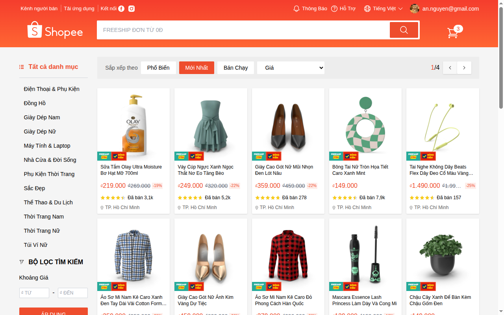
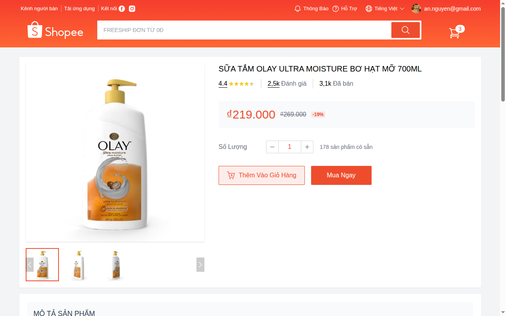
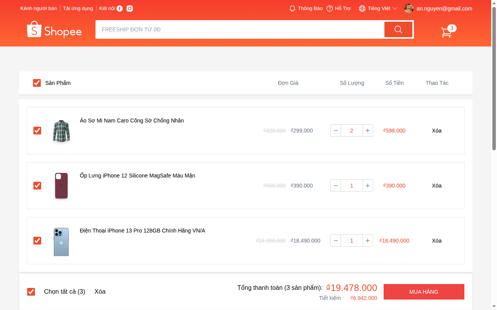
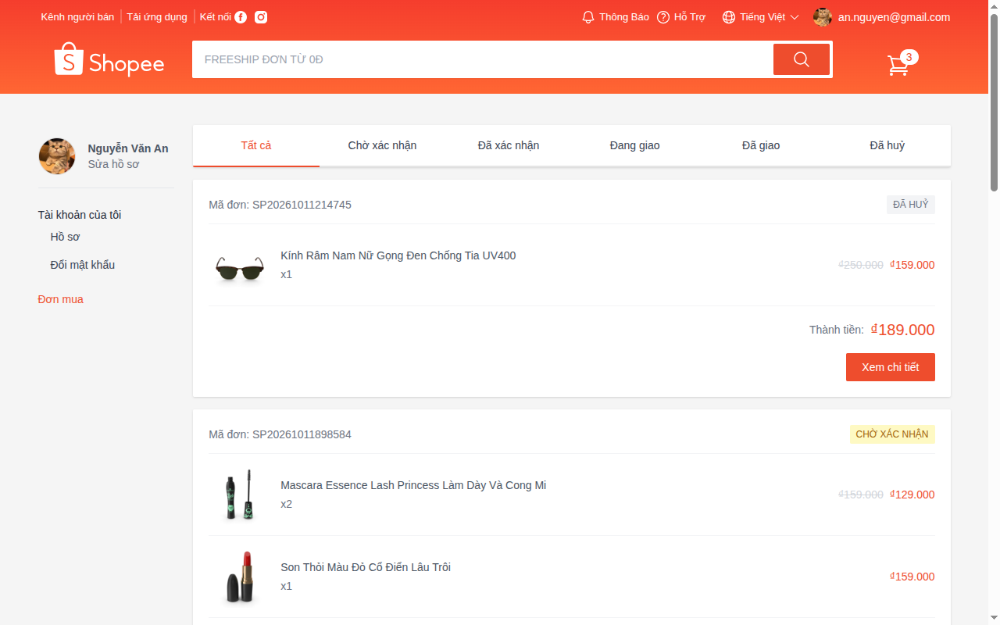
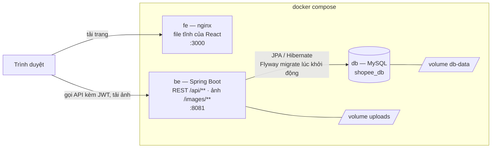

# Shopee Clone

Ứng dụng thương mại điện tử mô phỏng Shopee: backend REST API viết bằng Spring Boot và frontend React cho người
mua, chung một repo. Người mua đi được trọn luồng: đăng ký → tìm và xem sản phẩm → giỏ hàng → đặt và huỷ đơn →
hồ sơ và đổi mật khẩu. Backend theo chuẩn REST thông dụng của hệ sinh thái Java (trả DTO trần, lỗi theo RFC 9457,
JWT kèm refresh token xoay vòng); thiết kế API và database ghi đầy đủ trong `docs/`.

Chạy cả hệ thống (MySQL, backend, frontend) bằng một lệnh `docker compose up` — xem [Chạy thử](#chạy-thử).

| Danh sách sản phẩm | Chi tiết sản phẩm |
|---|---|
|  |  |
| **Giỏ hàng** | **Đơn mua** |
|  |  |

## Trạng thái

| | Trạng thái |
|---|---|
| **Backend** | **Đủ 29 endpoint** (bảng ở `docs/API_SPEC.md` mục 1.10). Có: đăng ký, đăng nhập, đăng xuất bằng JWT kèm refresh token (xoay vòng, phát hiện token bị lộ, tự dọn token quá hạn); phân quyền USER/ADMIN theo từng nhóm endpoint; xử lý lỗi theo RFC 9457; hồ sơ cá nhân; danh mục; sản phẩm có phân trang, lọc, sắp xếp, album ảnh, xoá mềm; giỏ hàng; đặt hàng, xem đơn và huỷ đơn; admin xem mọi đơn, đổi trạng thái đơn theo máy trạng thái, xem danh sách người dùng; upload ảnh sản phẩm và avatar; gỡ sản phẩm thì tự dọn khỏi giỏ hàng của mọi người |
| **Frontend** | Xong phần người mua: danh sách và chi tiết sản phẩm (tìm kiếm, lọc, phân trang), đăng ký/đăng nhập với refresh token tự đổi, giỏ hàng, đặt hàng (từ giỏ hoặc "Mua ngay"), đơn mua (tab trạng thái, chi tiết, huỷ), hồ sơ kèm avatar, đổi mật khẩu. Cách nối với API ở `docs/API_SPEC.md` mục 12. Chưa có màn quản trị |
| **Đóng gói** | Schema quản lý bằng Flyway migration, dữ liệu mẫu là migration riêng bật theo profile. Mỗi nửa có Dockerfile; `docker-compose.yml` dựng cả hệ thống từ máy trống |

## Cấu trúc

```
docs/                Tài liệu thiết kế dùng chung cho cả hai nửa
BE/                  Spring Boot — REST API, port 8081
FE/                  React + Vite — port 3000
docker-compose.yml   MySQL + BE + FE
```

## Kiến trúc



nginx chỉ phục vụ file tĩnh đã build; trình duyệt gọi thẳng backend ở cổng 8081 (CORS cho phép origin
`localhost:3000`). Lúc khởi động, backend chạy Flyway trước: DB trống thì dựng schema và nạp dữ liệu mẫu, DB đã
có thì chỉ chạy migration mới. Dữ liệu MySQL và ảnh upload nằm trong volume nên còn nguyên khi tạo lại container.

## Tech stack

**Backend** — Java 21 · Spring Boot 4.1 (Spring Framework 7, Spring Security 7) · Spring Data JPA /
Hibernate · MySQL · Flyway · JJWT 0.12 · Bean Validation · Maven

**Frontend** — React 18 · TypeScript 5 · Vite 5 · TailwindCSS 3 · TanStack Query 5 ·
React Hook Form + Yup · React Router 6 · Axios

**Đóng gói** — Docker (build nhiều giai đoạn) · Docker Compose · nginx

## Tài liệu thiết kế

Toàn bộ thiết kế nằm trong `docs/` và khớp với code hiện tại:

| File | Nội dung |
|---|---|
| [`docs/API_SPEC.md`](docs/API_SPEC.md) | Contract API giữa hai nửa. Mục **1.10** là bảng tổng hợp cả 29 endpoint: ai gọi được (công khai / đã đăng nhập / ADMIN), đã làm chưa, và màn frontend nào gọi tới kèm route của màn đó |
| [`docs/DATABASE_DESIGN.md`](docs/DATABASE_DESIGN.md) | Schema 8 bảng, kèm lý do đằng sau từng quyết định (vì sao giỏ hàng không lưu giá, vì sao đơn hàng phải snapshot, vì sao chưa làm biến thể sản phẩm) |
| [`docs/SYSTEM_DESIGN.md`](docs/SYSTEM_DESIGN.md) | Lộ trình mở rộng khi lượng truy cập tăng — chưa cần cho phiên bản hiện tại |

Vài quyết định thiết kế đáng chú ý ở backend:

- **Response thành công trả DTO trần**, không bọc trong `{ message, data }`. Trạng thái nằm ở HTTP status.
- **Lỗi theo RFC 9457 Problem Details** (`type`, `title`, `status`, `instance`) với
  `Content-Type: application/problem+json`. `type` là chuỗi ổn định để client rẽ nhánh logic —
  ví dụ token hết hạn trả `/errors/token-expired` để frontend tự gọi refresh, khác với đăng nhập sai
  mật khẩu dù cả hai đều là `401`.
- **Lỗi phát sinh trong servlet filter cũng trả đúng định dạng đó.** `@RestControllerAdvice` không với
  tới được tầng filter, nên có `AuthenticationEntryPoint` và `AccessDeniedHandler` riêng.
- **Phân quyền hai tầng**: Spring Security trả lời "đã đăng nhập chưa, role gì"; còn "bản ghi này có
  thuộc về người đang gọi không" là việc của tầng service, và trả `404` chứ không phải `403` để không
  tiết lộ rằng bản ghi đó tồn tại.
- **Đơn hàng chụp lại (snapshot)** tên, giá, ảnh sản phẩm và thông tin nhận hàng tại lúc đặt. Sản phẩm
  đổi giá hay bị gỡ khỏi sàn thì đơn cũ vẫn hiển thị đúng như lúc mua.
- **Tồn kho đúng cả khi nhiều người mua cùng lúc.** Kiểm tra và trừ kho nằm trong cùng một câu `UPDATE`
  có điều kiện; bấm "Đặt hàng" hai lần không tạo ra hai đơn; huỷ đơn khoá dòng để kho không bị hoàn hai
  lần. Đã thử bằng request gửi song song: 20 người cùng mua 5 món cuối → đúng 5 đơn, 15 người nhận `409`
  (cách đo ở `docs/DATABASE_DESIGN.md` mục 5).
- **Hai request cùng lúc trùng ràng buộc `UNIQUE`** (email, tên danh mục, dòng giỏ, mã đơn) thì request đến
  sau nhận `409` thay vì `500`; dữ liệu dài quá cột bị chặn ở validation (`422`) trước khi xuống database.
- **Refresh token xoay vòng và tự phát hiện token bị lộ.** Access token chỉ sống 15 phút; mỗi lần đổi
  token thì token cũ bị thu hồi và cấp token mới. Một token đã đổi rồi mà vẫn bị gửi lên nghĩa là có hai
  người cùng cầm nó, nên mọi phiên đăng nhập của người đó bị thu hồi. Database chỉ lưu bản băm SHA-256 của
  refresh token, không lưu chuỗi gốc.

## Chạy thử

### Cách 1 — Docker (một lệnh)

**Cần có:** Docker có Compose v2.

```bash
cp .env.example .env    # rồi điền DB_PASSWORD (tuỳ ý) và JWT_SECRET — cách tạo secret ghi ngay trong file
docker compose up --build
```

Mở `http://localhost:3000`, đăng nhập bằng `an.nguyen@gmail.com` / `123456` (các tài khoản khác ở
[dữ liệu mẫu](#schema-và-dữ-liệu-mẫu)). Lần đầu build mất vài phút vì phải tải thư viện; các lần sau dùng cache.
Thiếu `.env` thì compose dừng ngay và báo tên biến còn thiếu. `docker compose down` dừng hệ thống và giữ dữ
liệu; thêm `-v` để xoá luôn DB và ảnh, lần chạy sau dựng lại từ đầu.

MySQL trong container không mở cổng ra máy, nên không đụng MySQL đã cài sẵn; cổng 3000 và 8081 thì phải trống.

### Cách 2 — chạy từng phần (để phát triển)

**Cần có:** JDK 21, MySQL 8, Node 18+

#### Backend

```bash
cd BE
cp .env.example .env    # rồi điền DB_PASSWORD và JWT_SECRET — cách tạo secret ghi ngay trong file
./mvnw spring-boot:run
```

Lần chạy đầu, app tự tạo database `shopee_db`, rồi **Flyway** dựng 8 bảng và nạp dữ liệu mẫu. Không cần chạy
câu SQL nào bằng tay.

Secret không nằm trong `application.properties`: file đó chỉ ghi `${JWT_SECRET}` và `${DB_PASSWORD}`, giá trị
lấy từ biến môi trường hoặc từ `BE/.env` (không commit; biến môi trường thật được ưu tiên). Thiếu thì app
không khởi động và báo tên biến còn thiếu.

API chạy ở `http://localhost:8081`. Ảnh upload lưu ở `BE/uploads/` (tính từ thư mục chạy app, đường dẫn đầy
đủ in ra log lúc khởi động) và được phục vụ ở `/images/**`.

#### Schema và dữ liệu mẫu

Schema nằm trong các file migration ở `BE/src/main/resources/db/migration`, chạy lúc
app khởi động; Hibernate chỉ kiểm entity có khớp schema không (`docs/DATABASE_DESIGN.md` mục 9). Dữ liệu mẫu là
migration riêng ở `db/seed`, chỉ chạy khi bật profile `demo` — `./mvnw spring-boot:run` và `docker compose` tự
bật nó; chạy thẳng file jar thì không. Dữ liệu gồm 12 danh mục, 69 sản phẩm (207 ảnh nằm sẵn trong
`BE/src/main/resources/seed/images`, lấy từ bộ dữ liệu mẫu miễn phí DummyJSON), 8 đơn ở đủ các trạng thái và 5
món trong giỏ. Tài khoản, mật khẩu đều là `123456`: `admin@shopeeclone.vn` (ADMIN), `an.nguyen@gmail.com`,
`linh.tran@gmail.com`, `minh.le@gmail.com`.

Thử nhanh:

```bash
curl -X POST http://localhost:8081/api/auth/register \
  -H 'Content-Type: application/json' \
  -d '{"email":"test@gmail.com","password":"123456"}'
```

Đăng ký luôn tạo tài khoản role `USER`; tài khoản ADMIN có sẵn trong dữ liệu mẫu.

#### Frontend

```bash
cd FE
npm install
npm run dev
```

Chạy ở `http://localhost:3000` — origin này đã được cấu hình CORS ở backend.

## Những gì chưa làm

Liệt kê thẳng để khỏi phải đọc code mới biết:

- Ảnh upload lưu trên đĩa của máy chạy app — chạy nhiều server thì phải chuyển sang object storage; file
  upload rồi không dùng tới chưa được dọn
- Chưa có màn quản trị ở frontend — các endpoint admin hiện gọi bằng curl hoặc Postman
- **Gần như chưa có test tự động**: chỉ có một test kiểm app khởi động được (cần MySQL đang chạy), chưa có CI.
  Các API được kiểm bằng cách chạy app rồi gọi thật từng ca và đối chiếu status code, phần đặt hàng thử cả
  request gửi song song; các màn frontend kiểm trên trình duyệt. Các script kiểm đó chưa nằm trong repo
- Người dùng không xoá trống được tên, số điện thoại, địa chỉ đã nhập: backend hiểu `null` là "đừng đổi"
  (`docs/API_SPEC.md` §4.2)
- Mất response lúc đổi refresh token (mạng rớt đúng lúc) thì người dùng bị đăng xuất; backend chưa có thời gian
  ân hạn cho token vừa bị thu hồi (`docs/API_SPEC.md` §3.4)
- Access token không thu hồi được: đăng xuất và đổi mật khẩu thu hồi refresh token ngay, nhưng access
  token đang cầm vẫn dùng được tới khi hết hạn (tối đa 15 phút); đổi role trong database cũng cần tối đa
  chừng đó mới có hiệu lực
